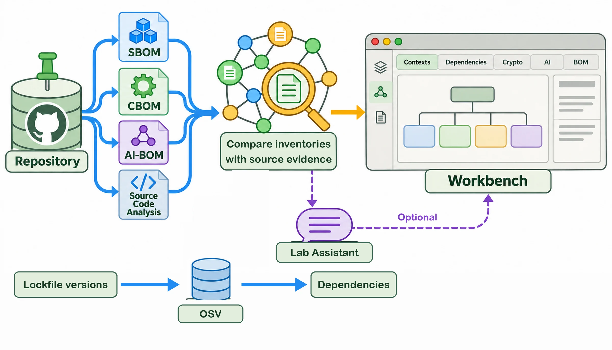

# OpenTrace

**One repository, one verified commit, three bills of materials, and the source evidence behind each claim.**

> Research prototype for a hackathon submission. It is **not** a production security scanner and does not remediate anything. License scope and evaluation status: [below](#license-and-evaluation).

## What OpenTrace helps a reviewer decide

The **Workbench** puts a repository's software (SBOM), cryptographic (CBOM) and AI (AI-BOM) bills of materials side by side, pinned to one GitHub commit that OpenTrace resolved and verified. Where a scan recorded a source location, the item shows the file and line it came from; where none was recorded, the view says so. Each view also states what it did *not* establish.

Using the same verified commit for all three inventories and the source evidence lets a reviewer compare claims against the files from that exact revision, without mixing evidence from different versions of a repository.

A reviewer can answer:

- Which components, algorithms and models does this commit declare, and where in the source?
- Which package versions have advisories (OSV lookup), and which are only in a lockfile and not in the SBOM?
- Where do the three inventories disagree or stay silent, so a human knows what still needs checking?

An advisory match does not show that vulnerable code runs. A source observation does not show runtime use. The interface repeats those limits next to the evidence.

## Quick start

**Prerequisites:** Git, Docker Desktop or Docker Engine with Compose v2, and Python 3.10+ (the launcher uses only the standard library). On Windows, start Docker Desktop in **Linux-container mode**. The default profile needs no API key or configuration file.

**macOS/Linux**

```sh
git clone https://github.com/bikashshah15/OpenTrace-Workbench.git
cd OpenTrace-Workbench
python3 tools/start.py
```

**Windows PowerShell**

```powershell
git clone https://github.com/bikashshah15/OpenTrace-Workbench.git
Set-Location OpenTrace-Workbench
py -3 tools/start.py
```

If `py -3` is unavailable, use `python tools/start.py` only when `python --version` reports Python 3.10 or newer.

If you previously cloned OpenTrace on Windows, clone into a new folder to ensure Git checks out the bundled Frigate evidence with its original line endings.

Open <http://127.0.0.1:8765/>. Select **Scan** to analyze a public GitHub repository, or use the header’s **Demo ↗** control to open the recorded Frigate case. Stop the stack with `docker compose -p opentrace stop`.

| Startup profile | What it enables | Requirements |
|---|---|---|
| **`no-llm` (default)** | Starts the Workbench and isolated scanner worker. Supports live Syft SBOM and cdxgen CBOM scans, supported static source observations, and OSV lookups by default for eligible packages found in live lockfiles. It can also display the captured Frigate AI-BOM in the replay. Live Cisco AI-BOM generation and the Lab Assistant are disabled. | No key or `opentrace.yml`. The Workbench needs outbound HTTPS to GitHub for live scans and `api.osv.dev` for OSV; the scanner worker has no network. Set `OPENTRACE_LIVE_ADVISORIES=0` to opt out of OSV. |
| **`with-llm` (opt in)** | Starts the Workbench and scanner worker plus live Cisco AI-BOM and Lab Assistant services. | Run `python3 tools/start.py --profile with-llm`. Requires an OpenAI key stored in a readable file outside the checkout, `opentrace.yml` configured from [`opentrace.example.yml`](opentrace.example.yml), the Cisco AI-BOM images built offline, a current owner-verified local pricing record, and a supported Docker platform. The launcher requires `llm.assistant_billing_verified: true` even though the example config comments it as optional; without `true`, startup is refused. See [Optional Cisco AI-BOM and Lab Assistant](#optional-cisco-ai-bom-and-lab-assistant) for the required order and linked instructions. |

See [Troubleshooting](#troubleshooting) if Docker is unavailable or the launcher reports an existing stack.

## Troubleshooting

### OpenTrace stack already exists

The launcher uses the Compose project name `opentrace` by default. `docker compose -p opentrace stop` stops its containers and leaves them in that project. If you previously ran `with-llm`, starting the default `no-llm` profile can report **An OpenTrace stack already exists** and **Nothing was changed**, even when every listed container is stopped. The launcher detected containers from the previous profile and is waiting for you to confirm replacement.

To switch that stack to `no-llm`, run the launcher with `--replace`:

- **macOS/Linux** — `python3 tools/start.py --profile no-llm --replace`
- **Windows PowerShell** — `py -3 tools/start.py --profile no-llm --replace` (or use `python` as in Quick Start)

Replacement clears any in-memory scans, sessions, or Assistant chats. Reload open OpenTrace browser tabs afterward. Named volumes and ledgers are preserved. A stopped `no-llm` stack can be reused, while restarting a stopped `with-llm` stack can also require replacement. Follow the launcher’s instructions for the profile and project you intend to use.

If you want both checkouts to have separate stacks, give each a distinct `--project` name. Use a different free `--port` for each stack if both will run at the same time.

### Docker unavailable or port in use

Start Docker Desktop or the Docker Engine service and check `docker compose version`. On Windows, use Linux-container mode. If port 8765 is occupied, add `--port 8766` to the launcher command or set `OPENTRACE_PORT=8766`.

## Frigate demo walkthrough (recorded replay)

This opens a **recorded replay** of a live scan of [blakeblackshear/frigate](https://github.com/blakeblackshear/frigate) at commit `3bca9b8676846d175f6b9f53f5818cbb9d36ec3e`, captured on 2026-11-23. It reads the saved artifacts and makes no scanner, OSV, GitHub or model call. It is **not** a fresh scan and **not** a reproduction of any benchmark.

1. Open the Workbench, then click the header’s **Demo ↗** control.
2. The banner reads "Replay of a recorded scan of commit 3bca9b867684". The header chips show 1,861 component records, 4,569 declared dependency edges, 44 advisory groups and 97 items to review in BOM connections.
3. Use the tabs under **Repository workbench**. Three examples follow, one per BOM.

**[Run the 12 replay tests](docs/REPRODUCIBILITY.md#3-primary-check-the-12-replay-tests)** for the published Frigate case study. From the repository root, the documented commands are:

```bash
pip install -r requirements-dev.txt
PYTHONPATH=src/core:src/agents/investigator python3 -m unittest tests.core.app.test_demo_replay
```

Expected result: `Ran 12 tests ... OK`. These replay tests check saved artifacts and selected outputs; they do not run a fresh scan or verify parity with the original live session. See [docs/REPRODUCIBILITY.md](docs/REPRODUCIBILITY.md) for the scope and limitations.

| BOM | Where to click | What the record shows | Evidence |
|---|---|---|---|
| **SBOM coverage:** `types-peewee` | **BOM connections** → **Focused gaps** → type `types-peewee` in the search box → select the result | "Not represented · missing component": `types-peewee` is declared with a wildcard pin at `docker/main/requirements-dev.txt:4`, but the SBOM has no component of that name among 1,848 library components, although it lists the same requirements file. The inspector calls this an inventory discrepancy (coverage gap), "not a completeness defect or vulnerability", and says installation or runtime use is not established. | [syft-sbom.cdx.json](src/core/opentrace_core/app/demo/frigate-3bca9b8/syft-sbom.cdx.json); declared line: `copies` entry for `docker/main/requirements-dev.txt` in [source-declarations.json](src/core/opentrace_core/app/demo/frigate-3bca9b8/source-declarations.json) (base64; line 4 is `types-peewee == 4.0.*`). The check itself is recomputed from these two files at replay |
| **CBOM coverage:** `md5` | **Cryptography** → **List** → `md5` | cdxgen reported zero cryptographic assets. OpenTrace separately recorded two source call sites, `frigate/detectors/detector_config.py:253` and `:256`, labelled *Experimental source observation*. The inspector says security concern is **Not assessed**: an algorithm name alone is not a finding, and runtime use is not observed. | [cdxgen-cbom.cdx.json](src/core/opentrace_core/app/demo/frigate-3bca9b8/cdxgen-cbom.cdx.json) (1,988 components, 0 cryptographic assets); `crypto_call_sites` in [source-declarations.json](src/core/opentrace_core/app/demo/frigate-3bca9b8/source-declarations.json); [line 253 on GitHub](https://github.com/blakeblackshear/frigate/blob/3bca9b8676846d175f6b9f53f5818cbb9d36ec3e/frigate/detectors/detector_config.py#L253) |
| **AI source evidence, partial AI-BOM coverage:** `hailo_platform` | **AI models** → **List** → search `hailo` → `hailo_platform` | A runtime recorded at two source imports, `frigate/detectors/plugins/hailo.py:147` and `frigate/util/services.py:1075`. The tab is marked **Partial AI-BOM · Coverage incomplete**. An import does not show the runtime is installed or active; provider, model version and license are unknown. | `ai_source.runtimes` in [source-declarations.json](src/core/opentrace_core/app/demo/frigate-3bca9b8/source-declarations.json); [cisco-aibom.cdx.json](src/core/opentrace_core/app/demo/frigate-3bca9b8/cisco-aibom.cdx.json) (scan ran degraded, 121 degraded results) |

All coverage here is partial. An empty or short list does not show that nothing is missing, and none of these records is a vulnerability finding.

## Live scan walkthrough

The default `no-llm` profile supports live scans, distinct from the recorded replay above. In the home page's **Review a repository** card, enter a public repository root URL (for example, the form's documented shape `https://github.com/owner/repository`) in **GitHub repository URL**, then select **Scan ↗**. The service resolves and verifies one full commit SHA; during the scan, the status view identifies the repository and pinned commit. When complete, the **Repository workbench** header shows the repository and abbreviated commit, with live scan evidence. Review the available **Repository contexts**, **Dependencies**, **Cryptography**, **AI models**, and **BOM connections** views.

The Workbench container needs outbound HTTPS to `api.github.com` and `github.com` to resolve, fetch, and verify a public repository, and to `api.osv.dev` for the default live advisory lookup. The scanner worker has no network. Live advisory lookup sends eligible lockfile package ecosystem, name, and exact version to OSV; opt out with `OPENTRACE_LIVE_ADVISORIES=0`. For live lockfile parsing, the Python Investigator asks the Go Evidence Specialist to parse lockfiles over NLIP. The Frigate replay does not exercise this path. This workflow is documented from the implementation; no live repository output or NLIP exchange is presented here as a verified example.

## License and evaluation

- **License:** original OpenTrace code, documentation and project artwork are MIT-licensed, © 2026 Bikash Shah, Peiran Shi and Narges Zare (see [LICENSE](LICENSE)). This includes the comparison engine imported from the team's BOMBridge project. The logo and architecture image were generated with ChatGPT. The license does **not** cover third-party material: the vendored UI libraries, the Frigate excerpts and package metadata in the replay, and OSV advisory records. These stay under their owners' licenses; notices are in [THIRD_PARTY_NOTICES.md](THIRD_PARTY_NOTICES.md).
- **Evaluation:** one case study of the recorded Frigate scan, with scope, method, results and limitations, in [docs/EVALUATION.md](docs/EVALUATION.md). It is not a benchmark and computes no accuracy.

## Reproduction links

| What | Link |
|---|---|
| SBOM (Syft 1.51.1) | [syft-sbom.cdx.json](src/core/opentrace_core/app/demo/frigate-3bca9b8/syft-sbom.cdx.json) |
| CBOM (cdxgen 12.9.0) | [cdxgen-cbom.cdx.json](src/core/opentrace_core/app/demo/frigate-3bca9b8/cdxgen-cbom.cdx.json) |
| AI-BOM (Cisco AI-BOM 1.10.1) | [cisco-aibom.cdx.json](src/core/opentrace_core/app/demo/frigate-3bca9b8/cisco-aibom.cdx.json) |
| Scan record (commit, tool commands, isolation, counts) | [scan-record.json](src/core/opentrace_core/app/demo/frigate-3bca9b8/scan-record.json) |
| BOM connections result (comparison of declarations with the SBOM) | [bombridge-result.json](src/core/opentrace_core/app/demo/frigate-3bca9b8/bombridge-result.json) |
| Source evidence (requirement-file copies, crypto call sites, model URLs, runtime imports) | [source-declarations.json](src/core/opentrace_core/app/demo/frigate-3bca9b8/source-declarations.json) |
| Advisory (OSV) lookup log and report | [advisory-lookup.json](src/core/opentrace_core/app/demo/frigate-3bca9b8/advisory-lookup.json), [advisory-report.json](src/core/opentrace_core/app/demo/frigate-3bca9b8/advisory-report.json) |
| Fixture manifest (SHA-256 of every file) | [MANIFEST.json](src/core/opentrace_core/app/demo/frigate-3bca9b8/MANIFEST.json) |
| Replay tests | [tests/core/app/test_demo_replay.py](tests/core/app/test_demo_replay.py) |
| Reproduction instructions and limits | [docs/REPRODUCIBILITY.md](docs/REPRODUCIBILITY.md) |
| Case study (scope, method, results, limitations) | [docs/EVALUATION.md](docs/EVALUATION.md) |
| Fixture builder and parity tool (need the private capture) | [tools/demo_replay/](tools/demo_replay/) |

The replay verifies the bundled files against MANIFEST.json and checks the three BOMs against the hashes in the scan record. It rebuilds the Workbench views from the saved inputs. The replay tests check artifact hashes, expected BOM connections counts, and selected results. Comparison against the original live session uses a separate parity tool and requires the private capture.

**What it does not verify, and what still needs to be supplied:** that rerunning the scanners reproduces these bytes (that needs a fresh scan: network access, the pinned tools and the Docker setup); the private raw capture directory, which is not in this repository, so the fixture builder and `tools/demo_replay/verify_replay.py` cannot be rerun from here; and any benchmark. **No benchmark is reproduced**, and there is no measured comparison against other scanners or agents.

## How it works



1. You give a public GitHub URL. OpenTrace resolves it to a full commit SHA and fetches that source with git.
2. A scanner worker in a separate Linux container with **no network** (read-only source, no capabilities) runs Syft (SBOM) and cdxgen (CBOM). Static collectors add source observations (Python `hashlib` calls, TLS settings, model URLs, runtime imports).
3. Cisco AI-BOM runs in a **separate, optional AI worker** on an internal network; its only outbound route is a gateway that holds the provider key. It is off in the default profile. The recorded Frigate AI-BOM was produced this way in the original live scan.
4. OpenTrace's comparison rules are deterministic: code checks declarations against the SBOM and builds the Workbench views. The Cisco AI-BOM was generated with model assistance through the provider gateway; the model does not make the comparison decisions.
5. With live lookup on, exact lockfile versions go to OSV (ecosystem, name and version only).

**NLIP is used in one place:** when lockfile packages are looked up live, a Python Investigator asks a Go Evidence Specialist over NLIP to parse the lockfiles. The recorded Frigate replay does not exercise this path. See [docs/ARCHITECTURE.md](docs/ARCHITECTURE.md) for the components.

<!-- Keep this alias for docs/REPRODUCIBILITY.md links. -->
<a name="optional-live-features"></a>

## Optional Cisco AI-BOM and Lab Assistant

The default profile works without these features. Enabling them requires a deliberate setup; do not put key contents in the config file or checkout.

1. Create a key file outside the checkout and configure the opt-in profile:

   ```bash
   cp opentrace.example.yml opentrace.yml   # git-ignored; set llm.api_key_file to the absolute key-file path
   ```

   Set `llm.provider: openai`, use an absolute path to the key file, and set `llm.assistant_billing_verified: true` only after independently verifying how OpenAI bills the token-count endpoint. Although the example comments that setting as optional, `tools/start.py` refuses `with-llm` startup unless it is `true`. OpenAI is the only supported live provider.

2. Make a local copy of the intentionally expired pricing template, then follow the gateway's [pricing and key custody instructions](deploy/docker/gateway/README.md#what-the-operator-does-for-a-live-validation-l1-not-part-of-this-change) to verify official pricing and update the validity dates and sources in your copy. The gateway refuses dispatch without a current, matching record.

   ```bash
   mkdir -p .opentrace
   cp -n deploy/docker/gateway/pricing.json .opentrace/aibom-pricing.json
   ```

3. Build the Cisco AI-BOM images offline using [`tools/uip07c/build_aibom_images.py`](tools/uip07c/build_aibom_images.py) and the [optional Cisco AI-BOM phase instructions](deploy/docker/README.md#optional-cisco-ai-bom-phase-uip-07c-off-by-default). The launcher checks that the required images exist. Its documented Docker support is limited to the tested Docker Desktop 4.98.0 (245422), Engine 29.9.2, `linux/arm64`, VM kernel 7.0.14-linuxkit platform; see the linked [platform and preflight instructions](deploy/docker/README.md#optional-cisco-ai-bom-phase-uip-07c-off-by-default).

4. Run the launcher preflight and then start the profile:

   ```bash
   python3 tools/start.py --profile with-llm --check
   python3 tools/start.py --profile with-llm
   ```

`--check` validates the config, key file and billing flag, pricing record, required images, Docker platform, and read-only Cisco isolation preflight. It starts nothing and makes no change. A successful preflight does not build images, test Docker secret access, create the broker token, or prove a provider call or live scan succeeds; the launcher performs remaining startup checks and service verification during the real start.

The launcher passes key-file paths, not secret contents, and mounts the key through Docker secrets. Live provider requests can incur charges subject to the documented gateway and Assistant limits. This README does not present a verified Lab Assistant session, answer, or citation example.

## Layout

`src/` runtime, `tests/`, `tools/`, `contracts/`, `evidence/` (test and renderer fixtures only), `deploy/`, `docs/`. The project was formerly called Open Ecosystem Change Lab.

## Acknowledgments

OpenTrace builds on [Syft](https://github.com/anchore/syft), [cdxgen](https://github.com/CycloneDX/cdxgen), [Cisco AI-BOM](https://github.com/cisco-ai-defense/aibom), [OSV](https://osv.dev/) and the BOMBridge engine (imported into this repository as the comparison engine), and uses [Frigate](https://github.com/blakeblackshear/frigate) as the recorded demonstration subject. Frigate and the scanners remain under their own licenses.
